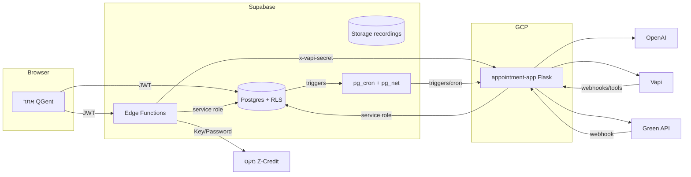

# QGent – סקירת מערכת לפני עלייה לייצור

תאריך הבדיקה: 21 באוקטובר 2026
היקף: מסד הנתונים החי ב-Supabase (`pcslxlckklfmkaskkbry`), פונקציות Edge, אפליקציית React, שירותי Google Cloud Run בפרויקט `savorai-497807`, והקוד של שרת השותף (`appointment-app`) כפי שהוא פרוס בפועל ב-Cloud Run.
שיטה: קריאה בלבד. לא שונו נתונים, הרשאות או קוד במהלך הבדיקה. ערכי סודות לא הוצגו ולא נשמרו.

---

## 0. תקציר

**המערכת עדיין לא מוכנה לייצור.** הפונקציונליות עובדת, אבל יש ארבע פרצות שכל אחת מהן לבד מאפשרת לזר לקרוא או לשנות נתונים של עסקים אחרים, או לגנוב מפתח של ספק:

1. **נקודות הקצה של הסוכן הקולי (Vapi) בשרת השותף לא מאומתות.** `VAPI_SECRET` לא מוגדר, והקוד מוותר על הבדיקה כשהוא חסר. כל אחד יכול לקבוע, לבטל, להזיז ולקרוא תורים, ולקבל שם, אימייל ומגדר של לקוח.
2. **וואטסאפ בייצור חייב לעבור ל-API הרשמי של Meta, עם אימות חתימה.** Green API הוא חיבור זמני לפיתוח עד שאימות Meta יאושר, ונשאר כמו שהוא בינתיים. ה-webhook שלו לא מאומת (`GREENAPI_WEBHOOK_TOKEN` לא מוגדר), ולכן לא לחבר אליו לקוחות אמיתיים. הדרישות למעבר מופיעות בסעיף 3.5.
3. **מפתח Vapi יכול לדלוף.** כשמורידים הקלטה מכתובת שהגיעה בבקשה, ואם הכתובת מחזירה 401, הקוד שולח שוב את אותה בקשה עם `VAPI_API_KEY` לאותה כתובת זרה.
4. **פונקציית `scheduler` ב-Supabase לא בודקת שייכות לעסק.** כל משתמש מחובר, וההרשמה פתוחה לכולם, יכול לפעול על התורים של כל עסק שהוא יודע את המזהה שלו.

בנוסף:
- כל הסודות בשרת השותף שמורים כמשתני סביבה גלויים, ו-Secret Manager לא מופעל בפרויקט.
- בעל עסק יכול להסיר מעצמו את חסימת החיוב.
- בפיתוח, וואטסאפ עובר דרך Green API, וזה זמני. לכן Meta לא שולחת היום נתוני חיוב, ו"מחיר Meta" שנרשם הוא הערכה עצמית. זה יתוקן במעבר ל-Meta.
- יש כמה טבלאות כפולות או מתות, ושלושה מקורות שונים למחירי OpenAI.

סדר העבודה המומלץ מופיע בסעיף 8.

---

## 1. ארכיטקטורה

### 1.1 הרכיבים

| רכיב | איפה | תפקיד |
|---|---|---|
| אתר הניהול (React + Vite) | Cloud Run `featurn-web`, europe-west1, ציבורי | ממשק לבעל העסק ולצוות: יומן, לקוחות, שירותים, לוגים, עלויות, הגדרות, כרטיס אשראי |
| Supabase Postgres | פרויקט `pcslxlckklfmkaskkbry` (eu-central-1) | מקור האמת לכל הנתונים. הרשאות לפי RLS ופונקציות |
| Supabase Auth | אותו פרויקט | התחברות באימייל וסיסמה או Google. 5 משתמשים, אף אחד בלי אימות דו-שלבי |
| Supabase Storage | bucket `recordings`, פרטי, עד 50MB לקובץ | הקלטות שיחות והודעות קוליות |
| Supabase Edge Functions | `scheduler`, `billing-start`, `billing-callback`, `billing-return`, `billing-charge`, `manage-business-users`, `rewrite-agent-prompt`, `purge-retention` | פעולות שדורשות סוד או הרשאת שרת |
| שרת השותף (Flask) | Cloud Run `appointment-app`, europe-west1, ציבורי | הסוכן הקולי (Vapi), סוכן וואטסאפ, פניות יזומות, רישום שימוש, ניקוי שיחות, מודול "איכות" |
| Vapi | ספק חיצוני (ארה"ב) | שיחות טלפון קוליות עם AI |
| Green API | ספק חיצוני | חיבור לוואטסאפ דרך WhatsApp Web, לא ה-API הרשמי של Meta |
| OpenAI | ספק חיצוני (ארה"ב) | המודל של סוכן הוואטסאפ (`gpt-6-luna`), תמלול הודעות קוליות, ניסוח תיאור עסק, שופט איכות |
| מקס / Z-Credit | ספק סליקה | שמירת כרטיס בעמוד מתארח וחיוב לפי טוקן |
| בנק ישראל | מקור ציבורי | שער דולר חודשי ממוצע (`fx_monthly_rates`) |
| Cursor | ספק חיצוני | מודול האיכות יכול להפעיל סוכן שכותב קוד במאגר של השותף |

שירותים ישנים ב-me-west1 (ישראל): `savorai-save-call`, `smart-scheduler`, `vapi-llm-endpoint`, `vapi-llm-fastapi`, `whatsapp-test`, וגם `priority-out-call` ב-europe-west1. הם לא פתוחים לציבור (אין `allUsers`), אבל עדיין מחזיקים מפתחות OpenAI, ו-`whatsapp-test` מחזיק גם טוקן של Meta. לא נמצא שימוש בהם בזרימות הנוכחיות.

### 1.2 זרימות עיקריות



- **קביעת תור מהאתר:** הקריאה עוברת דרך RPC `create_appointment_with_services`, שבודקת תפקיד. אפשר גם דרך `scheduler`, שמעביר לשרת השותף.
- **הזזה או ביטול ביומן:** טריגר על `appointments` מכניס שורה ל-`outreach_jobs`, ו-pg_net שולח `/outreach/dispatch` לשרת השותף. השרת שולח וואטסאפ או מתקשר דרך Vapi.
- **וואטסאפ נכנס:** Green API קורא ל-`/whatsapp/webhook`. משם השרת מעביר ל-OpenAI עם כלים (קביעה, ביטול, זמינות), שולח תשובה, וכותב `conversation_logs`, `whatsapp_agent_sessions` ו-`usage_events`.
- **שיחה קולית:** Vapi קורא לכלים בשרת השותף. בסוף השיחה נשלח `end-of-call-report`, והשרת כותב את הלוג, את ההקלטה ואת אירוע השימוש.
- **כרטיס אשראי:** `billing-start` יוצר עמוד אצל מקס. אחרי מילוי הכרטיס `billing-callback` מאמת מול `GetSessionStatus`, ורק אז שומר טוקן.

---

## 2. מפת הטבלאות

מקרא לעמודת ההמלצה: **להשאיר** = חלק ממה שהמערכת צריכה. **לאחד** = כפילות. **להסיר** = לא בשימוש. **לבדוק** = תלוי בהחלטה עסקית.

### 2.1 ליבה תפעולית

| טבלה | שורות | תפקיד | כותב | קורא | המלצה |
|---|---|---|---|---|---|
| `businesses` | 6 | פרטי העסק, שעות פעילות, מסלול, שמירת הקלטות, חסימת חיוב, ניקוי | האתר (בעלים/מנהל), טריגרים | הכל | להשאיר. **לחסום עדכון של עמודות חיוב** (סעיף 5) |
| `business_members` | 5 | מי שייך לאיזה עסק ובאיזה תפקיד (owner/admin/staff) | `create_business`, `manage-business-users` | RLS, כל הפונקציות | להשאיר |
| `clients` | 17 | כרטיס לקוח: שם, טלפון, ת"ז, תאריך לידה, כתובת | האתר, שרת השותף | האתר, שרת השותף | להשאיר. מכיל ת"ז, ולכן רגיש (סעיף 7) |
| `services` | 74 | קטלוג שירותים, משך ומחיר | האתר | הכל | להשאיר |
| `statuses` | 46 | סטטוסי תור לכל עסק | האתר, טריגר יצירת עסק | האתר | להשאיר |
| `appointments` | 102 | התורים | האתר, שרת השותף | הכל, realtime | להשאיר |
| `appointment_services` | 92 | שירותים בתוך תור, כולל צילום של המחיר | RPC | האתר | להשאיר |
| `business_blockouts` | 0 | חסימות זמן | אף אחד | אף אחד | **להסיר**, או לחבר. ימים מיוחדים מנוהלים ב-`working_hours` |

### 2.2 שיחות, הקלטות ופניות

| טבלה | שורות | תפקיד | המלצה |
|---|---|---|---|
| `conversation_logs` | 125 | לוג לכל שיחה קולית או שיחת וואטסאפ: תמלול, סיכום, כלים, משך, `initiated_by` | להשאיר. זו גם הטבלה שממנה מחושב החיוב ללקוח |
| `recordings` | 103 | מטא-דאטה לקבצי הקלטה ב-Storage | להשאיר |
| `whatsapp_agent_sessions` | 3 | זיכרון השיחה של בוט הוואטסאפ: הודעות מלאות, טוקנים, מי פתח | להשאיר, אבל **אין עליה ניקוי**, והיא מחזיקה היסטוריית הודעות מלאה |
| `outreach_jobs` | 72 | תור פניות יזומות: תזכורות, הזזה, ביטול, אישור, סגירה | להשאיר |
| `conversation_settings` | 0 | הגדרות שמירת תמלול והקלטה והסכמה, לכל עסק | **לאחד** עם השדות ב-`businesses` (`save_recordings`, `*_retention_*`). שרת השותף קורא את שני המקומות וסותר את עצמו |

### 2.3 מחירים, שימוש וחיוב

| טבלה | שורות | תפקיד בפועל | המלצה |
|---|---|---|---|
| `plan_tariffs` | 2 | **המחירון ללקוח**: מנוי, משתמשים, אחסון, אגורות לדקה, אגורות לחלון וואטסאפ | להשאיר. זה מקור המחיר ללקוח |
| `business_tariff_overrides` | 0 | מחיר מיוחד לעסק מסוים | להשאיר |
| `usage_events` | 547 | יומן גולמי של כל פעולה שעולה כסף לספק | להשאיר |
| `usage_prices` | 6 | **עלות הספק** לכל סוג פעולה בדולר, כולל עמודות OpenAI שהוספנו | להשאיר, אבל **לאחד** מחירי OpenAI למקור אחד |
| `model_token_rates` | 2 | מחיר OpenAI לפי מודל (כניסה ויציאה). **שרת השותף מחשב ממנה בפועל** | **כפילות** עם `usage_prices`. להחליט על מקור אחד (סעיף 3.4) |
| `fx_monthly_rates` | 1 | שער דולר חודשי מבנק ישראל | להשאיר |
| `billing_accounts` | 3 | "יתרת קרדיטים" שיורדת עם כל פעולה. כל היתרות היום שליליות | **להסיר או להקפיא.** זה מודל ישן של תשלום מראש שלא משמש לחיוב |
| `payment_methods` | 0 | טוקן כרטיס ממקס (בעמודה `cg_card_id`) ו-4 ספרות אחרונות | להשאיר. לשקול להצפין את הטוקן |
| `billing_sessions` | 0 | סשן שמירת כרטיס מול מקס | להשאיר |
| `billing_charges` | 0 | יומן חיובים לפי טוקן | להשאיר |
| `monthly_bills` | 0 | חשבון חודשי (קוד CreditGuard של השותף) | **לבדוק.** לא פעיל ולא מחובר למקס. אם נשאר, לחבר לחישוב שבאתר |
| `subscriptions`, `subscription_plans`, `subscription_charges` | 0 | מנוי (קוד השותף) | **להסיר**. המסלול נשמר ב-`businesses.subscription_plan` והמחיר ב-`plan_tariffs` |
| `promotion_campaigns` | 2 | הנחת "חבר מביא חבר" 10% (פעילה) | **לבדוק.** ההנחה פעילה אבל לא מופיעה בעמוד העלויות |
| `promotion_grants`, `referrals` | 0 | הנחות שהוענקו והפניות | לבדוק יחד עם הנ"ל |
| `openai_price_sync_requests` | 0 | עבודת עזר לעדכון השבועי של מחירי OpenAI | להשאיר |

### 2.4 מודול האיכות (של השותף)

`quality_findings` (37), `quality_proposals` (2), `quality_prompt_lines` (0), `quality_review_state` (1). מודול שסורק שיחות, מזהה כשלים ומציע שורות לפרומפט או תיקון קוד דרך Cursor. **לבדוק**: הוא שולח ציטוטי לקוחות ל-OpenAI ול-Cursor, וההצעות חלות על כל העסקים יחד. לפני ייצור צריך להחליט אם הוא נשאר, ואם כן, להסיר ממנו מידע מזהה.

### 2.5 סכמת `private`

`outreach_webhook_config`, `conversations_purge_config`: כתובת וסוד לקריאות pg_net לשרת השותף. אין להן גישה מהאתר, וזה תקין. כדאי להעביר את הסודות ל-Vault, כמו `purge_secret`.

### 2.6 עבודות מתוזמנות (pg_cron)

| עבודה | תדירות | מה עושה | הערה |
|---|---|---|---|
| `purge-expired-tenant-data` | יומי 01:20 | מחיקת הקלטות, לוגים, תורים ושימוש לפי מדיניות שמירה (שלנו) | **חופף** ל-`conversations-purge`. צריך מדיניות אחת |
| `conversations-purge` | יומי 03:20 | ניקוי שיחות בשרת השותף | ראו למעלה |
| `outreach-retry-due` | כל 5 דקות | ניסיון חוזר לפניות שנכשלו | |
| `outreach-reminders-due` | כל 5 דקות | תזכורות לפני תור | |
| `quality-review` | כל 3 שעות | סריקת איכות | |
| `sync-openai-prices` | כל שעה, בפועל פעם בשבוע | עדכון מחירי OpenAI מהאתר הרשמי | מעדכן רק את `usage_prices`, לא את `model_token_rates` |

---

## 3. מחירים: מאיפה, מה נכלל ומה לא

יש **שני עולמות נפרדים**, וחשוב לא לערבב ביניהם:

- **מחיר ללקוח:** מה שהעסק משלם ל-QGent. נקבע במחירון שלנו (`plan_tariffs`).
- **עלות ספק:** מה ש-QGent משלמת ל-OpenAI, Vapi, Meta/Green API. נרשם ב-`usage_events.amount_usd` ו-`amount_ils`. זה מידע פנימי לרווחיות, **לא נכנס לחשבון ללקוח**.

### 3.1 מחיר ללקוח (מה שמוצג בעמוד "עלויות")

המקור הוא `plan_tariffs`. אם יש שורה ב-`business_tariff_overrides`, היא גוברת שדה-שדה. אם הטעינה נכשלת, האתר נופל לקטלוג קשיח בקוד (`planPricing.ts`).

| | רגיל | מורחב |
|---|---|---|
| מנוי חודשי (כולל מע"מ) | 99 ₪ | 199 ₪ |
| משתמשים כלולים / תוספת למשתמש | 2 / 40 ₪ | 4 / 30 ₪ |
| אחסון כלול / תוספת לג'יגה | 5 / 5 ₪ | 7 / 3 ₪ |
| שיחה קולית לדקה (לפני מע"מ) | 90 אג' | 70 אג' |
| חלון וואטסאפ שהלקוח פתח (לפני מע"מ) | 11 אג' | 9 אג' |
| חלון וואטסאפ שהעסק פתח (לפני מע"מ) | 25 אג' | 22 אג' |
| שמירת הקלטות / היסטוריה | 90 יום / 24 חודשים | 7 שנים / 84 חודשים |

**הנוסחה** (`planPricing.ts`, `monthChargeIls`):

```
סה"כ = מנוי
     + max(0, משתמשים − כלולים) × מחיר משתמש
     + (שניות קוליות / 60) × (אגורות לדקה / 100) × 1.18
     + חלונות לקוח × (אגורות לקוח / 100) × 1.18
     + חלונות עסק × (אגורות עסק / 100) × 1.18
     + max(0, מכסת אחסון − כלול) × מחיר לג'יגה
```

**מאיפה הכמויות** (RPC `business_plan_usage`, החודש הנוכחי לפי שעון העסק):
- משתמשים: חברים פעילים ב-`business_members`.
- דקות קוליות: סכום `duration_seconds` של `conversation_logs` בערוץ `vapi`.
- חלונות וואטסאפ: לוגים בערוץ `whatsapp`, מקובצים לפי טלפון. חלון חדש נפתח אם עברו 24 שעות מפתיחת החלון הקודם. מי פתח = `initiated_by` של הלוג הפותח. ריק נחשב כלקוח.
- אחסון: לפי **המכסה שהוגדרה**, לא לפי השימוש בפועל.

**מה לא נכלל במחיר ללקוח:** טוקנים של OpenAI, תמלול (Whisper), פניות יזומות (`outreach_dispatch`), הודעות וואטסאפ בודדות (נספר רק החלון), עלות הדולר של הספקים, יתרת `billing_accounts`, והנחות הפניה.

**פערים שנמצאו:**
1. הנחת "חבר מביא חבר" 10% פעילה בטבלה, אבל עמוד העלויות לא מחשב אותה. **הוחלט לדחות לשלב מאוחר יותר.** הטבלאות נשארות.
2. מסך בחירת המסלול (`PlanRates.tsx`) מציג תמיד את הקטלוג הקשיח, גם אם המחיר בטבלה או המחיר המיוחד לעסק שונים.
3. כשהטעינה נכשלת האתר מציג בשקט מחיר מהקוד. צריך להציג שגיאה.
4. אחסון מחויב לפי מכסה ולא לפי שימוש. זו החלטה עסקית לגיטימית, אבל צריך לכתוב אותה במפורש בתנאים.
5. סליקה וחשבונית עדיין "בפיתוח". אין היום מנגנון שגובה את הסכום החודשי בפועל.

### 3.2 איך נקבע "מי פתח" בוואטסאפ (`initiated_by`)

נקבע **בשרת השותף**, לא ב-Meta:
- הודעה נכנסת מלקוח פותחת סשן `customer`.
- פנייה יזומה (הזזה, ביטול או תזכורת מהיומן) פותחת סשן `business`.
- הסשן נשמר בזיכרון לפי טלפון, **למשך 30 דקות מהפעולה האחרונה** (`WHATSAPP_SESSION_MINUTES`), לא 24 שעות. הערך הראשון נשאר לכל אורך הסשן.

לכן:
- מה שאנחנו מחייבים (חלון של 24 שעות לפי הלוג הפותח) ומה שהשרת רושם (סשן של 30 דקות) הם שני מושגים שונים. בפועל הם מתיישבים, כי החיוב שלנו מסתכל רק על הלוג הפותח.
- אם השרת עולה מחדש, הסשן שבזיכרון נמחק, וההודעה הבאה עלולה להיחשב פתיחה חדשה.
- בשיחות קוליות `initiated_by` לא נרשם בכלל, גם בשיחות יוצאות.

### 3.3 מה אנחנו מקבלים מ-Meta (פייסבוק)

**כלום.** השרת עובד עם `WHATSAPP_PROVIDER=greenapi`:
- Green API מתחבר לוואטסאפ כמו WhatsApp Web, ולכן Meta לא מחייבת לפי שיחה ולא שולחת נתוני חיוב (`pricing`, `conversation.origin`, `billable`).
- Green API גובה מנוי חודשי קבוע לכל מספר.
- הערך `0.0053$` להודעה יוצאת שעסק פתח הוא **הערכה קשיחה בקוד** (`sql/fx_usage_costs.sql`), לפי תעריף utility של Meta. בפועל אף אחד לא משלם אותו.
- קוד חלופי ל-Meta קיים (`whatsapp/meta.py`), אבל הוא לא פעיל, לא קורא נתוני חיוב, ולא תומך בהודעות Template. בלי Template אי אפשר לפנות ללקוח אחרי 24 שעות ב-API הרשמי.

**החלטה:** Green API הוא חיבור זמני לפיתוח, עד שאימות העסק ב-Meta יאושר. בייצור עוברים ל-WhatsApp Cloud API הרשמי, ו-Green API יוסר. עד אז כל מה שקשור ל-Green API נשאר כמו שהוא.

**השלכות בינתיים:**
1. לא לחבר את Green API ללקוחות אמיתיים. ה-webhook שלו לא מאומת, והשימוש בו נוגד את תנאי השימוש של WhatsApp.
2. המחיר שלנו ללקוח (11/25 אג') לא תלוי בספק, כי זה תעריף שלנו. עלות הספק בוואטסאפ תהיה אמיתית רק אחרי המעבר ל-Meta.

### 3.5 מה צריך כדי לעבור ל-Meta

רוב העבודה בשרת השותף, ב-`whatsapp/meta.py` וסביבו:

1. **אימות webhook:**
 - לבדוק את הכותרת `X-Hub-Signature-256` מול App Secret בכל POST, ולדחות בקשה בלי חתימה תקינה.
 - בבקשת ה-GET לאימות, להשוות את `hub.verify_token` בזמן קבוע (`hmac.compare_digest`).
2. **קריאת כל ההודעות.** היום `meta.parse_webhook` קורא רק את ההודעה הראשונה ב-batch. צריך לעבור על כל ה-entries וכל ה-messages, ולמנוע כפילות לפי `message.id`.
3. **Templates:**
 - לאשר ב-Meta תבניות utility לתזכורת, הזזה, ביטול, אישור תור וסגירת עסק.
 - פנייה יזומה מחוץ לחלון 24 שעות חייבת להישלח כתבנית. בתוך החלון אפשר טקסט חופשי.
4. **נתוני חיוב:**
 - לקלוט את אירועי `statuses` מה-webhook, עם `pricing.category`, `pricing.billable` ו-`conversation.origin.type`.
 - לרשום ב-`usage_events` את העלות האמיתית לפי המחירון של Meta, במקום הקבוע 0.0053$.
5. **מי פתח את השיחה.** לקבוע `initiated_by` לפי חלון 24 שעות מההודעה האחרונה של הלקוח, ולשמור את החלון במסד הנתונים ולא בזיכרון. כך המצב לא נמחק כשהשרת עולה מחדש, והוא יתאים לחישוב החיוב באתר.
6. **הסכמה.** לתעד Opt-in של הלקוח לקבלת הודעות יזומות.
7. **סודות.**
 - להעביר ל-Secret Manager את טוקן ה-System User, את App Secret ואת Verify Token.
 - להסיר את משתני Green API ואת קוד `greenapi.py`.
 - לבטל את הטוקן הישן של Meta שנמצא בשירות `whatsapp-test`.

### 3.4 עלות ספק (פנימי)

הנוסחה בשרת השותף (`billing/usage.py`): `ILS = USD × שער בנק ישראל של החודש הקודם × (1 + markup)`.

| פעולה | מקור המחיר בדולר | הערה |
|---|---|---|
| `openai_tokens` | `model_token_rates`: כניסה ויציאה לכל מודל | luna: 0.10$/0.50$ למיליון. **תקין** |
| `vapi_call_seconds` | העלות ש-Vapi מדווחת. אם אין, `usage_prices` (0.05$ לדקה) | |
| `whatsapp_outbound` | `usage_prices` 0.0053$, רק כשהעסק פתח | **לא אמיתי עם Green API** |
| `whatsapp_inbound` | 0 | |
| `whisper_seconds` | `usage_prices` 0.00005$ לשנייה | נרשם גם כשהתמלול נכשל |
| `outreach_dispatch` | 0 | |

**שלושה מקורות למחיר OpenAI:**
- `model_token_rates`: ממנו השרת מחשב.
- העמודות שהוספנו ל-`usage_prices`: מתעדכנות אוטומטית מאתר OpenAI, והטריגר מחשב מהן מחדש את `amount_usd`.
- קבועים קשיחים ב-`conversations/whatsapp_log.py` (`estimated_cost` בלוג).

היום שלושתם זהים, אבל העדכון האוטומטי מעדכן רק את אחד מהם. **המלצה:** להשאיר את `model_token_rates` כטבלת המחירים לפי מודל, להעביר אליה את העדכון השבועי ואת עמודות המטמון וההקשר הארוך, ולהסיר את עמודות OpenAI מ-`usage_prices` ואת הקבועים מהקוד.

**עוד פערים:**
- `markup_percent` מוכפל כשבר: הערך 20 יגרום להכפלה פי 21. היום הוא 0 ולכן לא מורגש.
- `billing_accounts` יורד עם כל אירוע דרך `apply_usage_charge`, ולא משמש לשום דבר.
- `amount_credits` ב-`usage_events` הוא שארית מהמודל הישן. בספטמבר הוא "קרדיטים" ובאוקטובר בערך שקלים.
- אין מניעת כפילות לפי מזהה הודעה או שיחה. ניסיון חוזר של Green API או Vapi ירשום פעמיים.
- `end-of-call-report` מזויף יכול לרשום משך ועלות שרירותיים, אפילו שליליים.

---

## 4. ממצאי אבטחה

### 4.1 קריטי: לתקן לפני ייצור

| # | ממצא | איפה | תיקון |
|---|---|---|---|
| C1 | נקודות הקצה של Vapi (`/book`, `/cancel`, `/reschedule`, `/appointments`, `/vapi-init`, `/vapi-recording`) פתוחות לכל העולם, כי `VAPI_SECRET` לא מוגדר והבדיקה מדולגת. `assistant-request` מחזיר שם, אימייל ומגדר של לקוח | `appointment-app/app.py:454-462` | להגדיר `VAPI_SECRET`, להגדיר אותו ב-Vapi כ-server secret של האסיסטנט ושל כל כלי, ולשנות את הקוד כך שייכשל כשהסוד חסר |
| C2 | ה-webhook של וואטסאפ מקבל כל בקשה. היום הוא Green API, זמני לפיתוח ונשאר כמו שהוא, אבל אסור לחבר אליו לקוחות אמיתיים. בייצור עוברים ל-Meta | `whatsapp/greenapi.py:29-42`, `app.py:1400-1405`, `whatsapp/meta.py` | במעבר ל-Meta: אימות `X-Hub-Signature-256` שנכשל כשהחתימה חסרה (סעיף 3.5) |
| C3 | דליפת `VAPI_API_KEY`: הורדת הקלטה מכתובת שהגיעה בבקשה. אם מתקבל 401, הקוד שולח את המפתח לאותה כתובת | `conversations/recordings.py:570-603` | לשלוח את המפתח רק ל-`*.vapi.ai`, לא לעקוב אחרי הפניות, ולהוריד הקלטה רק לפי מזהה שיחה מה-API של Vapi |
| C4 | `scheduler` (Supabase) לא בודק שהמשתמש חבר בעסק שב-`business_code` | `supabase/functions/scheduler/index.ts:163-191` | לאמת את ה-JWT, לוודא חברות ותפקיד מול `business_members`, ולדרוס `business_code` בערך המאומת |

### 4.2 גבוה

| # | ממצא | תיקון |
|---|---|---|
| H1 | כל הסודות בשרת השותף הם משתני סביבה גלויים: מפתח service-role של Supabase, OpenAI, Vapi, Green API, Cursor. Secret Manager לא מופעל. כל מי שיש לו הרשאת צפייה ב-Cloud Run רואה אותם, וגם `deploy.ps1` מעביר אותם בגלוי | להפעיל Secret Manager, להעביר כל סוד ל-`--set-secrets`, ולהחליף (rotate) את כל המפתחות אחרי המעבר |
| H2 | בעל עסק או מנהל יכול לעדכן את `businesses.billing_hold`, `closed_at`, `is_active`, `subscription_plan`, `storage_quota_gb` ישירות דרך ה-API, ולהסיר חסימת חיוב | להגביל UPDATE לעמודות מותרות (column grants) או לעבור ל-RPC. עמודות החיוב רק דרך service role |
| H3 | חסימת עסק סגור או חסום נאכפת רק בדפדפן. RLS לא בודק `closed_at` או `billing_hold` | להוסיף את התנאי ל-`private.is_business_member` או לפוליסות הכתיבה |
| H4 | שיחה קולית: `client_phone` מגיע מהמודל ולא ממספר המתקשר, כך שאפשר לשכנע את הבוט לפעול על תור של אדם אחר | לקבע את הטלפון לפי caller ID של Vapi בצד השרת |
| H5 | הקלטות פועלות כברירת מחדל בלי הסכמה, ובשיחות יוצאות בלי הודעה. הודעות קוליות של **כל** שולח, כולל אנשי קשר פרטיים של בעל העסק, נשמרות ונשלחות ל-OpenAI לפני סינון | הקלטה רק אחרי הסכמה מתועדת, הודעת הקלטה בתחילת כל שיחה, ותמלול רק אחרי זיהוי שזו פנייה לעסק |
| H6 | פרטים אישיים (טלפון, שם, טקסט ההודעה) נכתבים ללוגים של Cloud Run. הלוגים לא נכללים בניקוי | להסיר או למסך PII בלוגים, ולהגדיר retention ל-Cloud Logging |
| H7 | מודול האיכות שולח ציטוטי לקוחות ל-OpenAI ול-Cursor, ויכול להפעיל סוכן שכותב קוד לפי טקסט שהגיע מלקוח (prompt injection לקוד). שורות הפרומפט חלות על כל העסקים | לכבות בייצור, או להסיר PII ולחייב אישור ידני מלא |
| H8 | אין אימות דו-שלבי לאף משתמש. סיסמה מינימלית 6 תווים בהרשמה. התחברות במצב `implicit` במקום PKCE | MFA חובה לבעלים ולמנהלים, סיסמה של 10 תווים לפחות עם בדיקת סיסמאות דולפות, ומעבר ל-`flowType: 'pkce'` |
| H9 | החשבון היחיד עם הרשאת Owner בפרויקט Google Cloud הוא Gmail פרטי | לוודא 2FA על החשבון, להוסיף חשבון חירום, ובהמשך Organization |

### 4.3 בינוני

- **הרשאות גורפות לטבלאות.** `anon` ו-`authenticated` מחזיקים INSERT, UPDATE, DELETE, TRUNCATE ו-TRIGGER על רוב הטבלאות (ברירת מחדל של Supabase). RLS חוסם את זה דרך ה-API, אבל צריך שכבת הגנה שנייה: `revoke all ... from anon`, ולתת ל-`authenticated` רק מה שהאתר צריך.
- **פונקציות שניתנות להפעלה בלי התחברות.**
 - `business_agents_allowed` לא בודקת מי קורא, ולכן כל אחד יכול לדעת אם עסק פעיל או חסום.
 - `apply_usage_charge` פתוחה ל-`anon`. RLS חוסם אותה היום.
 - פונקציות אחרות (`close_business_account`, `create_*`, `delete_*`) בודקות הרשאה בפנים, וזה תקין. עדיין כדאי `revoke execute ... from anon`.
- **אין כותרות אבטחה באתר** (CSP, HSTS, X-Frame-Options/frame-ancestors, Referrer-Policy, X-Content-Type-Options). האתר יכול להיות מוטמע ב-iframe זר (clickjacking). PCI DSS 4.0 דורש בקרת סקריפטים בעמוד שמפנה לתשלום.
- **SSRF ומניעת שירות.** הורדת מדיה מכתובות שמגיעות בבקשה, עם מעקב הפניות, עד 120 שניות ו-16–50MB. השרת רץ עם worker אחד ו-8 threads, כך שכמה בקשות כאלה יכולות לתקוע אותו.
- **אין מניעת שידור חוזר (replay)** ב-webhooks. אין חותמת זמן, nonce או בדיקת מזהה הודעה.
- **שיוך שגוי לעסק.**
 - אירועי שימוש של וואטסאפ נרשמים לעסק של ההתקנה ולא לעסק של הפנייה.
 - `fetch_running_call_job` מחפש לפי טלפון בכל העסקים.
 - מחיר ומשך התור בקביעה דרך הסוכן מגיעים מהמודל ולא מהקטלוג.
- **סוד אחד לכמה מטרות.** `CONVERSATIONS_PURGE_SECRET` פותח ניקוי, מסך איכות, נתוני שימוש והקלטות של כל העסקים.
- **CORS `*`** בכל שרת השותף ובכל פונקציות Edge.
- **הודעות שגיאה פנימיות** (`error.message`, `str(e)`) מוחזרות למשתמש.
- **אין הגבלת קצב** ב-`scheduler`, `billing-start`, `billing-charge`, וב-webhooks של השותף. ב-`rewrite-agent-prompt` ההגבלה בזיכרון בלבד, ולכן לא אמינה.
- **טוקן הכרטיס** שמור ב-`payment_methods.cg_card_id` בלי הצפנה ברמת האפליקציה. גישה רק ל-service role, וזה תקין, אבל מומלץ להצפין.

### 4.4 נמוך

- שני הקונטיינרים (האתר ושרת השותף) רצים כ-root.
- שרת השותף כולל בתמונה `tests/`, `.pytest_cache`, `supabase/.temp` ו-`docs/`.
- `.env` (כתובת Supabase ומפתח anon הציבורי) עדיין במעקב git. לא סוד, אבל כדאי להוציא.
- מזהה עסק ברירת מחדל ומזהה אסיסטנט קשיחים בקוד השותף.
- פונקציות SQL בלי `set search_path`: `try_numeric`, `usage_events_fill_cost` ועוד. הן לא definer, אבל ה-linter מסמן אותן.

### 4.5 מה תקין

- RLS מופעל על **כל** הטבלאות. הפוליסות מבוססות על `private.is_business_member` ו-`has_business_role`, עם `search_path=''`.
- פונקציות definer מגדירות `search_path`.
- שמירת כרטיס: הכרטיס מוזן רק בעמוד של מקס. `billing-callback` לא סומך על הקריאה ומאמת מול `GetSessionStatus`, יש נעילה אופטימית, אין שמירת מספר כרטיס או CVV, והטוקן לא נחשף לאתר.
- Bucket ההקלטות פרטי. האתר משתמש ב-URL חתום לשעה.
- סודות Z-Credit ו-OpenAI של פונקציות Edge נמצאים ב-Supabase Secrets ולא באתר. אין מפתחות בקוד ה-React.
- נקודות ה-outreach, הניקוי והאיכות בשרת השותף נכשלות כשהסוד חסר (fail closed).
- חשבון השירות של Cloud Run לא מחזיק תפקיד Editor.

---

## 5. דברים מיותרים וכפולים

| מה | המלצה |
|---|---|
| `subscriptions`, `subscription_plans`, `subscription_charges` (ריקות) | להסיר |
| `billing_accounts` ו-`apply_usage_charge` (יתרת קרדיטים שלילית) | להסיר, או להקפיא ולהפסיק לכתוב |
| `business_blockouts` (ריקה, בלי פוליסות) | להסיר |
| `conversation_settings` מול שדות השמירה ב-`businesses` | לאחד לטבלה אחת |
| מחירי OpenAI בשלושה מקומות | לאחד ל-`model_token_rates` (סעיף 3.4) |
| `usage_prices.amount_credits`, `usage_events.amount_credits` | להפסיק להשתמש. להשאיר רק `amount_usd` ו-`amount_ils` |
| כל קוד CreditGuard בשרת השותף (`billing/creditguard.py`, `routes.py`, `links.py`, `monthly.py`) ו-`docs/billing.openapi.yaml` | להסיר. הוחלף ב-Max דרך Supabase. אם יופעל בטעות, עלול לחייב פעמיים |
| `whatsapp/meta.py` | להשאיר ולהשלים. זה החיבור לייצור (סעיף 3.5) |
| `whatsapp/greenapi.py` ומשתני `GREENAPI_*` | להשאיר עד המעבר ל-Meta, ואז להסיר |
| שני ג'ובים של ניקוי (`purge-expired-tenant-data`, `conversations-purge`) | לאחד למדיניות אחת |
| 4 נתיבים ל-`/vapi-init` ונתיב ישן `/api/v1/slots` בלי אימות | להשאיר נתיב אחד מאומת |
| שירותי Cloud Run ישנים: `whatsapp-test`, `vapi-llm-endpoint`, `vapi-llm-fastapi`, `smart-scheduler`, `savorai-save-call`, `priority-out-call` | למחוק אחרי וידוא, ולבטל (revoke) את המפתחות שבהם |
| באתר: `useUsage.ts`, `usage.api.ts`, `usage.types.ts`, `usage.mappers.ts`; פונקציות מחיר לא בשימוש (`voiceChargeIls`, `extraUserChargeIls`, `monthlyPlanIls`); קבועי אחסון כפולים ב-`storageQuota.ts` | לנקות |
| מיגרציה `20261018210000_openai_token_prices.sql`, חלק הקריאה לפונקציית Edge שלא קיימת | הוחלפה ב-`20261018213000`. לנקות לפני שמריצים את כל המיגרציות מחדש |
| סכמת הבסיס לא נמצאת ב-`supabase/migrations` | לייצא schema מלא (`supabase db dump --schema public,private`) כ-baseline, כדי שאפשר יהיה להקים סביבה מחדש |

---

## 6. מוכנות לתקנים

| תקן | איפה אנחנו | פערים עיקריים |
|---|---|---|
| **חוק הגנת הפרטיות, תיקון 13** (בתוקף מאוגוסט 2025) | חלקי | אין הודעת איסוף ומדיניות פרטיות. אין הודעת הקלטה בשיחה יוצאת. הקלטה כברירת מחדל. אין מנגנון עיון ומחיקה לאדם בודד. ת"ז ותאריכי לידה נשמרים ונטענים בלי צורך. העברה לחו"ל (OpenAI, Vapi, Green API, Cursor) בלי רשימה ובלי הסכמי עיבוד מתועדים |
| **תקנות אבטחת מידע 2017** | חלקי | אין יומן גישה וביקורת (audit log) לשינויים בהרשאות, הגדרות וחיוב. אין MFA. אין נוהל ניהול סודות והחלפתם. צריך מסמך הגדרות מאגר ונוהל אבטחה. מאגר עם ת"ז ונתוני תקשורת כנראה ברמת אבטחה בינונית |
| **GDPR** (אם יש לקוחות מהאיחוד) | חלש | אין זכויות נושא מידע, אין בסיס חוקי מתועד להודעות קוליות של צד שלישי, ומודול האיכות משתמש במידע לא לפי המטרה |
| **PCI DSS 4.0 (SAQ-A)** | טוב יחסית | עמוד הסליקה מתארח, אין מספר כרטיס אצלנו. חסר CSP ובקרת סקריפטים בעמוד שמפנה לתשלום (6.4.3, 11.6.1), ואין MFA לגישה מנהלית |
| **ISO 27001 / SOC 2** (בקרות בסיס) | חלש | אין ניהול סודות מרכזי, אין לוג ביקורת, אין הפרדת סביבות (dev/prod על אותו פרויקט), אין גיבוי מתועד ובדיקת שחזור, ואין סריקת תלויות |
| **נגישות** (תקנות שוויון זכויות, ת"י 5568) | חסר | אין הצהרת נגישות, ולא בוצעה בדיקת WCAG 2.0 AA |
| **מדיניות WhatsApp Business** | ממתין למעבר ל-Meta | Green API זמני לפיתוח. בייצור נדרשים API רשמי, Templates מאושרות ו-Opt-in מתועד (סעיף 3.5) |

---

## 7. מידע אישי: מה נשמר ואיפה

| מידע | טבלה / מקום | זמן שמירה היום |
|---|---|---|
| שם, טלפון, אימייל, ת"ז, תאריך לידה, כתובת | `clients` | ללא הגבלה |
| תמלולים, סיכומים, קריאות כלים (כולל טלפון ושם) | `conversation_logs` | לפי מסלול (24 או 84 חודשים) |
| היסטוריית הודעות וואטסאפ מלאה | `whatsapp_agent_sessions` | **ללא ניקוי** |
| הקלטות והודעות קוליות | Storage `recordings` + `recordings` | לפי מסלול (90 יום עד 7 שנים) |
| ציטוטי לקוחות | `quality_findings`, `quality_proposals` | **ללא ניקוי** |
| תוכן פניות יזומות | `outreach_jobs.payload` | **ללא ניקוי** |
| טלפון, שם, טקסט | Cloud Logging | ברירת מחדל של Google (30 יום), **מחוץ לשליטה שלנו** |
| טוקן כרטיס ו-4 ספרות | `payment_methods` | עד החלפה |

**סגירת חשבון** (`close_business_account`) רק מסמנת את העסק כסגור, ולא מוחקת ולא מייצאת. צריך תהליך מחיקה מלא אחרי תקופה מוגדרת.

---

## 8. תוכנית עבודה מומלצת

### שלב א: חוסם עלייה לייצור (שבוע)
1. **C1:** להגדיר `VAPI_SECRET` בשרת השותף וב-Vapi, ולשנות לבדיקה שנכשלת כשחסר.
2. **C2:** חיבור וואטסאפ ל-Meta לפי סעיף 3.5, והסרת Green API. זה מותנה באישור האימות מ-Meta.
3. **C3:** לתקן את הורדת ההקלטות: המפתח רק ל-Vapi, בלי מעקב הפניות.
4. **C4:** בדיקת חברות ותפקיד בפונקציית `scheduler`.
5. **H1:** להפעיל Secret Manager, להעביר את כל הסודות, ולהחליף את כולם, כולל מפתח service-role של Supabase, OpenAI, Vapi, Green API ו-Cursor.
6. **H2 ו-H3:** לחסום עדכון עמודות חיוב ולאכוף חסימה ב-RLS.
7. **H8:** MFA לבעלים, סיסמה חזקה, PKCE.
8. לבטל הרשאות `anon` על טבלאות ופונקציות. לתקן את `business_agents_allowed`.
9. להוסיף כותרות אבטחה ב-nginx.
10. לפרסם מדיניות פרטיות, תנאי שימוש והצהרת נגישות.

### שלב ב: 30 יום
1. הקלטה רק בהסכמה, הודעת הקלטה בכל שיחה, ותמלול רק אחרי סינון.
2. להסיר PII מלוגים ולהגדיר retention ללוגים.
3. ניקוי ל-`whatsapp_agent_sessions`, `quality_*` ו-`outreach_jobs.payload`.
4. לאחד את מחירי OpenAI, להסיר `billing_accounts` ואת טבלאות המנוי הריקות, ולאחד את `conversation_settings`.
5. מניעת כפילות באירועי שימוש לפי מזהה הודעה או שיחה, ומניעת replay.
6. לתקן `markup_percent`.
7. יומן ביקורת לשינויי הרשאות, הגדרות וחיוב.
8. להפריד סביבת פיתוח מייצור.
9. למחוק את שירותי Cloud Run הישנים.

### שלב ג: המשך
1. סליקה חודשית אמיתית מול מקס, וחשבונית.
2. הנחת "חבר מביא חבר" 10%: מסך להזנת קוד הפניה, שיוך, והצגת ההנחה בעמוד העלויות ובחשבון החודשי.
3. תהליך עיון ומחיקה לנושא מידע ומחיקה מלאה של עסק סגור.
4. baseline מלא למיגרציות ובדיקת שחזור מגיבוי.
5. בדיקת חדירה חיצונית לפני השקה רחבה.

---

## נספח: מה לא נבדק

- הגדרות Supabase Auth בלוח הבקרה: תוקף קישורים, CAPTCHA, הגבלת הרשמה, SMTP.
- גיבויים ו-PITR ב-Supabase.
- ההגדרות בתוך Vapi ו-Green API: secrets, webhook URL, מי מורשה.
- הקוד של שירותי Cloud Run הישנים ב-me-west1.
- סריקת חולשות בתלויות (npm, pip).
- בדיקת נגישות בפועל.
